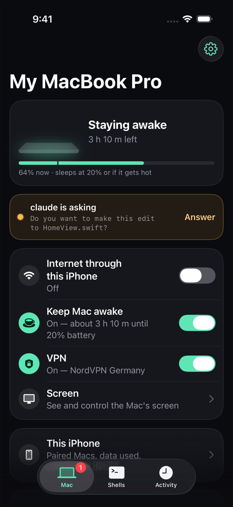
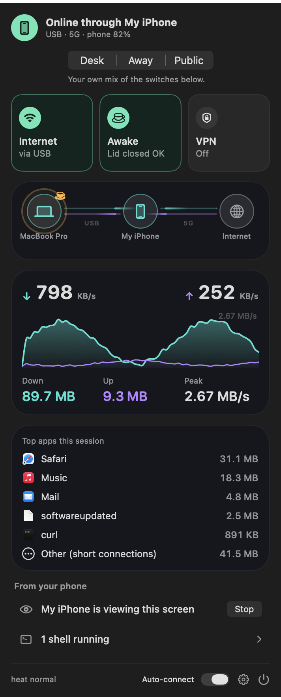
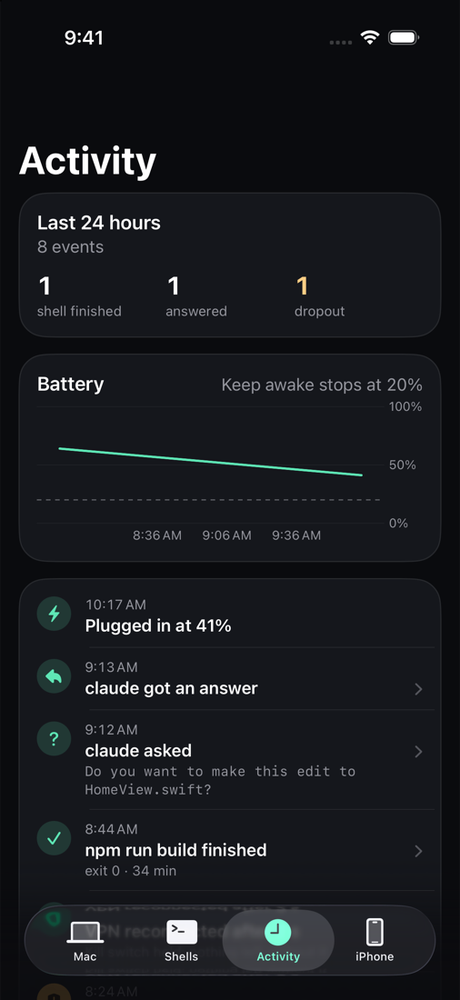
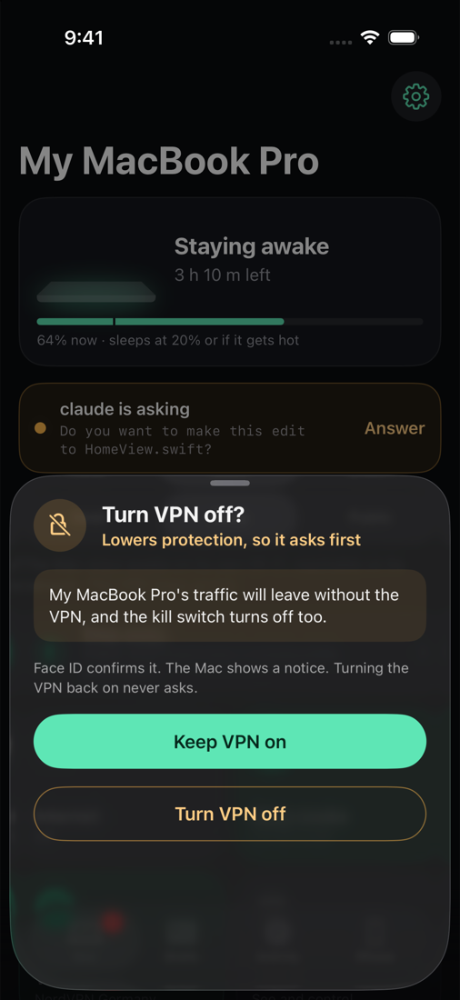
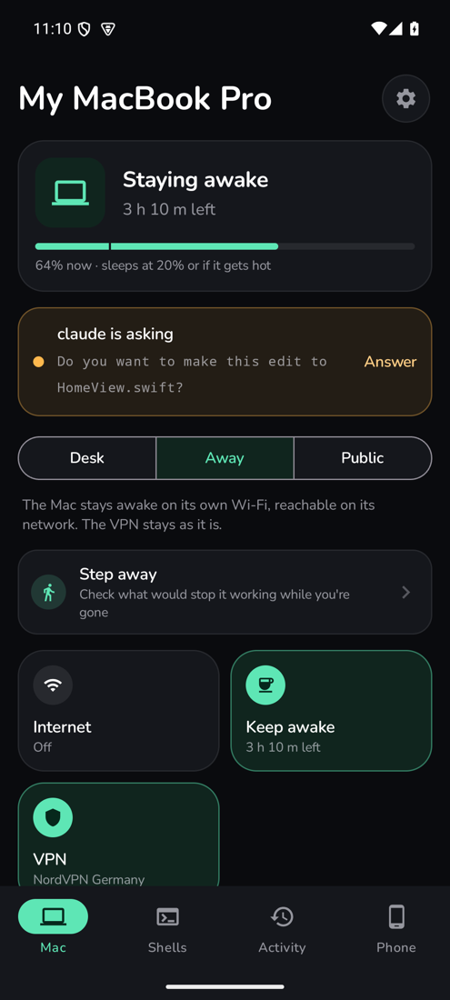
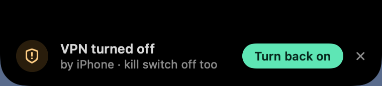
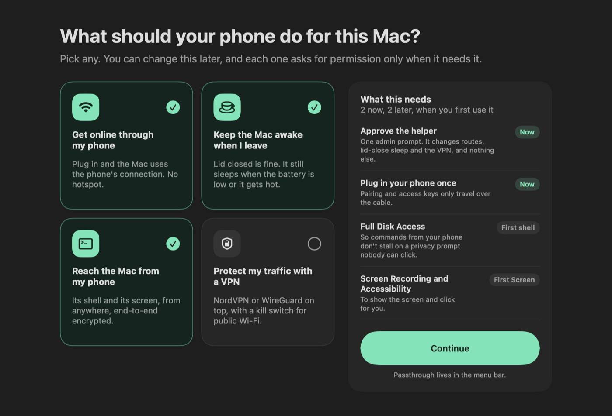

<h1 align="center">Passthrough</h1>

<p align="center"><b>Your phone, working for your Mac.</b><br>
Internet over the cable, a Mac that stays awake while you're gone, its shell from anywhere, and a VPN with a kill switch.<br>
For iPhone and Android, and an iPad through your iPhone. A Windows PC can be a host too. No accounts, no Passthrough server.</p>

<p align="center">Free and open source. If it saved your day (or your data plan), <a href="https://buymeacoffee.com/dwepat">buy me a coffee</a> ☕</p>

<p align="center">
  <picture>
    <source media="(prefers-color-scheme: light)" srcset="docs/images/iphone-mac-light.png">
    
  </picture>
  &nbsp;
  <picture>
    <source media="(prefers-color-scheme: light)" srcset="docs/images/mac-panel-light.png">
    
  </picture>
  &nbsp;
  
</p>

## What it does

| | |
|---|---|
| **Internet through your phone** | Plug in and the Mac goes online through the phone's own connection: no hotspot, nothing to configure. An optional wireless link carries the same traffic when you unplug. [More](docs/GUIDE.md#how-it-works) |
| **A Mac that stays awake** | Lid closed is fine. It still sleeps at your battery limit or when it runs hot, and the phone shows how long it has left. [More](docs/GUIDE.md#keep-mac-awake) |
| **Its shell, from anywhere** | A real terminal on your Mac from the phone: on the same Wi-Fi, over Tailscale, or from anywhere through a built-in end-to-end encrypted connection. Sessions survive disconnects and are recorded, and a session can be open in a terminal window on the Mac and on the phone at once. On iPhone and iPad you can also see and control the screen. [More](docs/GUIDE.md#remote-shell) |
| **An iPad online through your iPhone** | On the iPhone's Personal Hotspot, the iPad's traffic leaves from the iPhone's own connection through Passthrough, not as hotspot data. Pair them by scanning a code the iPad shows. On the Mac's cable the iPad is a remote for the shell and the screen. [More](docs/GUIDE.md#ipad) |
| **A VPN on top** | WireGuard or OpenVPN (NordVPN built in) with a kill switch, over the phone's connection or any other network. [More](docs/GUIDE.md#vpn-layer) |
| **A Windows PC as a host** | Pair a PC with a code typed into its tray flyout, turn on Remote access, and the phone opens PowerShell, Command Prompt, WSL or Git Bash on it from anywhere. Its screen goes over Windows' own Remote Desktop. Internet through the phone, the VPN layer and keep-awake are Mac only for now. [More](docs/GUIDE.md#windows) |
| **Your computers, shared** | From the phone, let one of your computers use another without the phone: a Mac sees another Mac's screen or a PC's in a window, and a PC opens a Mac's shell or screen. You choose what it may do, confirm with Face ID, and can take it back later. [More](docs/GUIDE.md#sharing-a-computer-with-another-computer) |

## Your Mac from the phone

The phone apps open on your Mac: three switches, **Internet through this phone**, **Keep Mac awake** and **VPN**, its battery and how long it stays awake, and any shell waiting on you. A switch that can't turn on right now says why, with the fix.

<p align="center">
  
  &nbsp;
  
</p>

* **Needs you**: when a shell goes quiet on a question, like Claude asking to make an edit, the phone shows it and opens the terminal right there.
* **Activity**: a timeline of what happened on the Mac, from the VPN reconnecting to a long-running shell finishing, with its battery as a line.
* **Without opening the app** (iPhone): turning Keep awake on starts a Live Activity that counts down the Mac's awake time in the Dynamic Island and on the Lock Screen; a widget, Control Center buttons and Shortcuts cover the rest.

## On the Mac

<p align="center">
  
  &nbsp;
  
</p>
<p align="center">
  
</p>

A menu-bar app with the same three switches; one that can't turn on says why and offers the fix. When the phone changes something, a notice grows out of the notch (or drops in under the menu bar on screens without one), and anything that lowers protection stays until someone at the Mac sees it. The icon says it all at a glance: online, awake, VPN on, a shell waiting on you, or something wrong. On first launch it asks what you want the phone to do and only asks for permissions when each one is first needed.

<p align="center"></p>

## Safe by design

* **Pairing happens over the cable**, with a six-digit code shown on the phone. Keys never travel any other way, except that an iPad pairs with its iPhone by a one-time QR code the iPhone scans (the camera stands in for the cable).
* **The phone's shell keys need Face ID** (or the passcode / screen lock) every time the app opens.
* **Turning protection down asks first.** Turning things on from the phone is one tap; turning the VPN off needs Face ID, works only inside the app, and leaves a notice on the Mac. Each phone's permission to change Keep awake and the VPN can be turned off on the Mac.
* **The Mac's limits always win**: Keep awake still stops at the battery limit or when it runs hot, whoever asked.
* **Sharing a computer is the host's call.** A phone can let another computer in only where the host allows that phone to share, it takes Face ID, and the shared Mac shows a notice. A shared PC keeps its screen closed until its owner allows it there.
* **No accounts, no Passthrough server.** "From anywhere" is end-to-end encrypted (iroh), through public relays or [your own](docs/GUIDE.md#self-hosting-a-relay).

Details in the [security model](docs/GUIDE.md#security-model) and [SECURITY.md](SECURITY.md).

## How it works

```
┌──────────── Mac ─────────────┐  USB or wireless   ┌──────────── Phone ─────────────┐
│ apps → utunN → tun2socks ────┼───────────────────▶│ SOCKS5 (loopback) → cellular   │
│          (root helper)       │ usbmuxd (iPhone)   │ iPhone: VPN extension          │
│ shell · keep awake · VPN     │ adb (Android)      │ Android: foreground service    │
│                              │ TLS / iroh (shell) │                                │
└──────────────────────────────┘                    └────────────────────────────────┘
```

The Mac routes its traffic into a tunnel that ends on the phone, and the phone opens each connection with its own network stack. The same pairing then carries everything else: the remote shell, the Mac's state, and your requests to change it. Both phone apps speak the [same protocol](protocol/README.md), so the Mac treats them alike, and the Windows host speaks it too.

## Requirements

| | Needs | To build it |
|---|---|---|
| **Mac** | macOS 14.5 or later, Apple Silicon | Xcode, [XcodeGen](https://github.com/yonaskolb/XcodeGen), an Apple Developer account |
| **iPhone, iPad** | iOS 17.5 or later | The same Mac and account. The iPhone's VPN extension needs a paid team. |
| **Android** | Android 8.0 or later (Remote shell: Android 10) | JDK 25 and the Android SDK; adb on the Mac (`brew install android-platform-tools`) |
| **Windows PC** | Windows 10 1809 or later, x64. Screen: Windows Pro or higher. A direct connection on your network: Windows 11. | The .NET 10 SDK and Rust, on the PC ([windows/README.md](windows/README.md)) |

The Mac and the phones update together: rebuild both from the same commit. There is no compatibility with older builds for now.

## Install

You build it yourself (there are no signed releases yet).

**1. Set up the project (once, on the Mac).**

```sh
brew install xcodegen
cp Config/Signing.xcconfig.example Config/Signing.xcconfig   # set DEVELOPMENT_TEAM to your Team ID
xcodegen generate && open Passthrough.xcodeproj
```

`Config/Signing.xcconfig` holds your Team ID and stays out of git. If your Mac's team is a free one, sign the iPhone app with a paid team there; see [Setup](docs/GUIDE.md#setup).

**2. iPhone (and iPad).** In Xcode, run the `Passthrough` scheme on the phone and tap the power button. iOS asks once to add the VPN configuration.

**3. Mac.** Build Release and put it in `/Applications`:

```sh
xcodebuild -project Passthrough.xcodeproj -scheme PassthroughMac -configuration Release \
  -derivedDataPath build -allowProvisioningUpdates build
ditto build/Build/Products/Release/Passthrough.app /Applications/Passthrough.app
```

Quit Passthrough first if it's running (menu bar ▸ power button), then copy it in and open `/Applications/Passthrough.app`. On first connect macOS asks you to allow its helper under *System Settings ▸ General ▸ Login Items & Extensions*. Use a Release build: the Release helper refuses a Debug app, so running `PassthroughMac` from Xcode is for development only.

**4. Pair.** Plug the phone in, flip the switch in the menu bar, and type the code the phone shows. For the shell and the screen, turn on Remote shell in the Mac's *Settings ▸ Remote Shell* and plug the phone in once more.

**Android.** Run `./gradlew installDebug` in `android/`, turn on USB debugging on the phone, and pair the same way.

**Windows PC.** On the PC, build with `scripts/build-windows.ps1` and run `Passthrough.exe` from `windows\artifacts\Passthrough`. Click its tray icon, plug the phone in, and type the code the phone shows into the flyout. Then turn on Remote access in its *Settings ▸ Remote access* (Windows asks for an administrator once) and plug each phone in once more. Build details and what to install first: [windows/README.md](windows/README.md).

**A PC's screen (optional).** The Remote Desktop engine that shows a PC's screen isn't in the repository yet. To build it: `brew install cmake ninja`, then `bash scripts/build-freerdp.sh` before you open the project in Xcode. Without it everything else builds and works, and the PC's screen is left out. More in [Setup](docs/GUIDE.md#a-pcs-screen-the-remote-desktop-engine).

**Phone notifications are optional and come from the build.** To have the Mac tell your iPhone when a shell needs you, put your APNs key (`AuthKey_<Key ID>.p8`, from *Certificates, IDs & Profiles › Keys*) in `Config/` and set `PASSTHROUGH_PUSH_KEY_FILE = Config/AuthKey_<Key ID>.p8` in `Config/Signing.xcconfig` before building the Mac app. Without it the build still works and sends no notifications; the widget and Live Activity still work. When reinstalling, keep that line and the `.p8` in place or notifications stop. Step-by-step setup (which Claude can follow too) is in the [changelog](CHANGELOG.md); more in [Notifications](docs/GUIDE.md#notifications).

The [full setup](docs/GUIDE.md#setup) covers bundle IDs, signing, the wireless link and recovery.

## More

* [**The full guide**](docs/GUIDE.md): every feature in depth, setup, failure recovery, troubleshooting and known limits
* [Wire protocol](protocol/README.md) · [Android notes](android/README.md) · [Windows](windows/README.md) · [Changelog](CHANGELOG.md) · [Contributing](CONTRIBUTING.md) · [Security](SECURITY.md) · [Third-party notices](THIRD_PARTY_NOTICES.md)

Released under the [MIT License](LICENSE).
