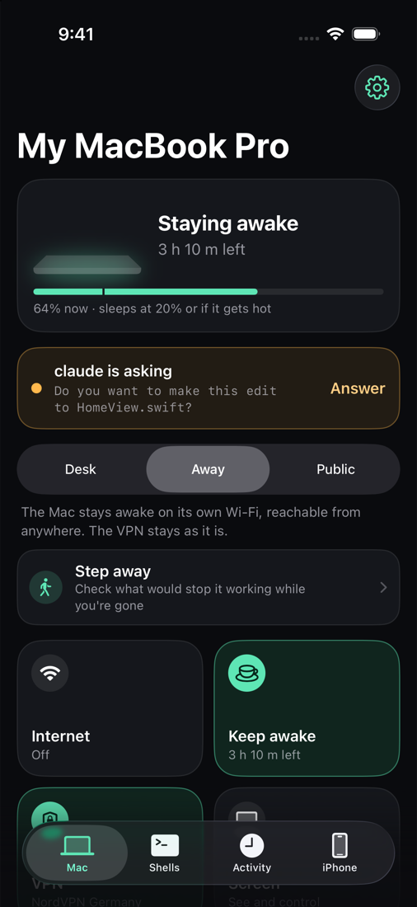
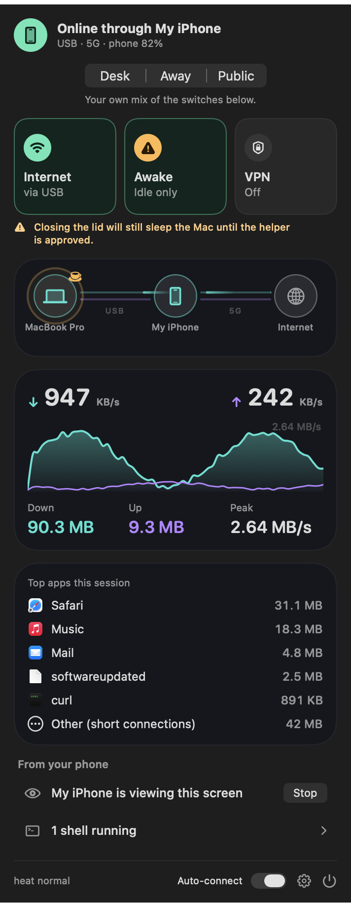
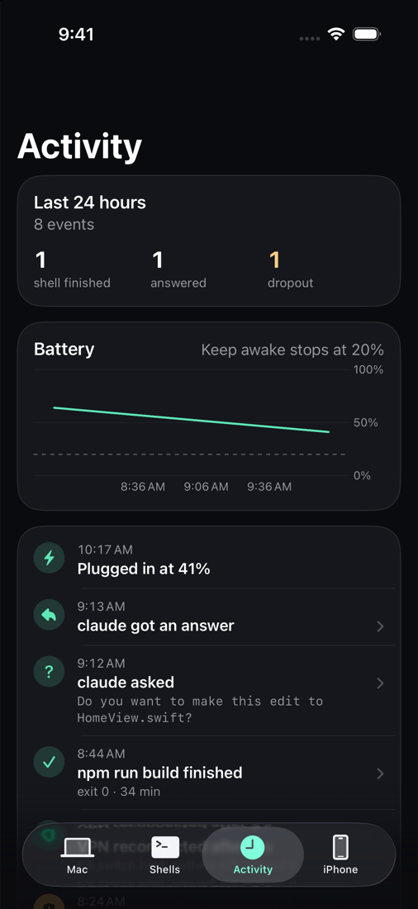
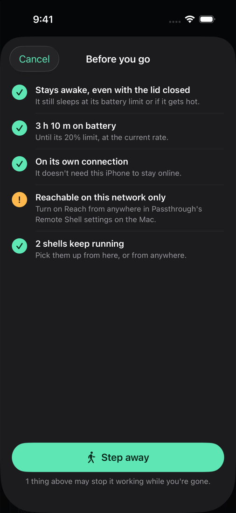
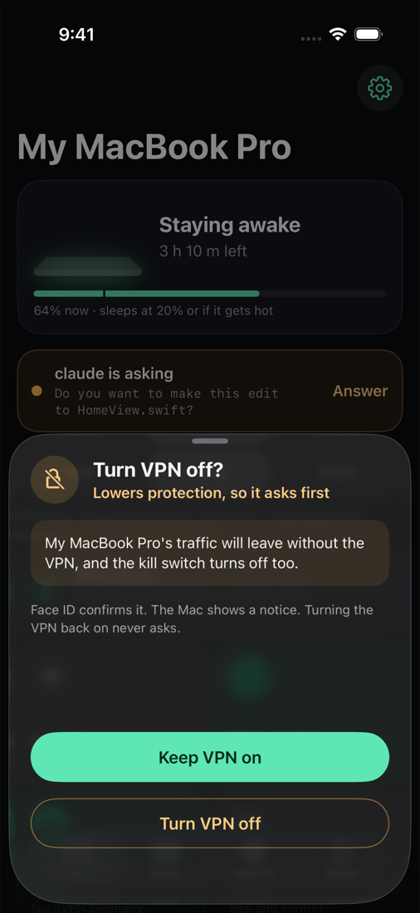
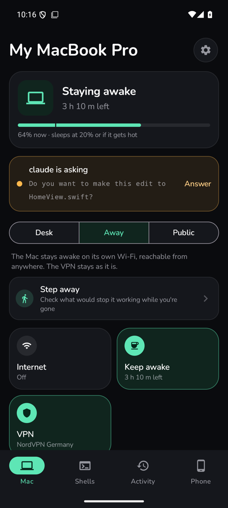
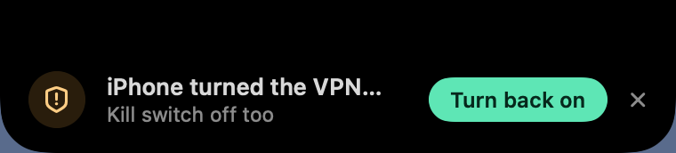
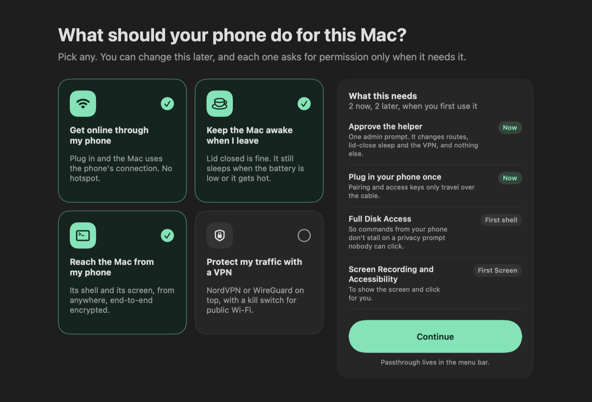

<h1 align="center">Passthrough</h1>

<p align="center"><b>Your phone, working for your Mac.</b><br>
Internet over the cable, a Mac that stays awake while you're gone, its shell from anywhere, and a VPN with a kill switch.<br>
For iPhone and Android. No accounts, no Passthrough server.</p>

<p align="center">
  <picture>
    <source media="(prefers-color-scheme: light)" srcset="docs/images/iphone-mac-light.png">
    
  </picture>
  &nbsp;
  <picture>
    <source media="(prefers-color-scheme: light)" srcset="docs/images/mac-panel-light.png">
    
  </picture>
  &nbsp;
  
</p>

## What it does

| | |
|---|---|
| **Internet through your phone** | Plug in and the Mac goes online through the phone's own connection: no hotspot, nothing to configure. An optional wireless link carries the same traffic when you unplug. [More](docs/GUIDE.md#how-it-works) |
| **A Mac that stays awake** | Lid closed is fine. It still sleeps at your battery limit or when it runs hot, and the phone shows how long it has left. [More](docs/GUIDE.md#keep-mac-awake) |
| **Its shell, from anywhere** | A real terminal on your Mac from the phone: on the same Wi-Fi, over Tailscale, or from anywhere through a built-in end-to-end encrypted connection. Sessions survive disconnects and are recorded. On iPhone you can also see and control the screen. [More](docs/GUIDE.md#remote-shell) |
| **A VPN on top** | WireGuard or OpenVPN (NordVPN built in) with a kill switch, over the phone's connection or any other network. [More](docs/GUIDE.md#vpn-layer) |

## Built around where you are

Instead of four switches, pick a **moment**. **Desk**: online through the phone, the Mac sleeps as usual. **Away**: the Mac stays awake on its own Wi-Fi, reachable from anywhere. **Public**: everything through the VPN. Both the phone and the Mac read the moment off the switches, so they always agree.

<p align="center">
  
  &nbsp;
  
  &nbsp;
  
</p>

* **Step away** checks what would bite once you're gone (asleep with the lid shut, battery, the Mac still online through the phone you're taking, reachable from anywhere) and fixes what it can before switching to Away.
* **Needs you**: when a shell goes quiet on a question, like Claude asking to make an edit, the phone shows it and opens the terminal right there.
* **While you were away**: a timeline of what happened on the Mac, from the VPN reconnecting to a build finishing, with its battery as a line.
* **Without opening the app** (iPhone): a Live Activity counts down the Mac's awake time in the Dynamic Island and on the Lock Screen; a widget, Control Center buttons and Shortcuts cover the rest.

## On the Mac

<p align="center">
  
  &nbsp;
  
</p>
<p align="center">
  
</p>

A menu-bar app with the same moments and switches. When the phone changes something, a notice grows out of the notch (or drops in under the menu bar on screens without one), and anything that lowers protection stays until someone at the Mac sees it. The icon says it all at a glance: online, awake, VPN on, a shell waiting on you, or something wrong. On first launch it asks what you want the phone to do and only asks for permissions when each one is first needed.

<p align="center"></p>

## Safe by design

* **Pairing happens over the cable**, with a six-digit code shown on the phone. Keys never travel any other way.
* **The phone's shell keys need Face ID** (or the passcode / screen lock) every time the app opens.
* **Turning protection down asks first.** Turning things on from the phone is one tap; turning the VPN off needs Face ID, works only inside the app, and leaves a notice on the Mac. Each phone's permission to change Keep awake and the VPN can be turned off on the Mac.
* **The Mac's limits always win**: Keep awake still stops at the battery limit or when it runs hot, whoever asked.
* **No accounts, no Passthrough server.** "From anywhere" is end-to-end encrypted (iroh), through public relays or [your own](docs/GUIDE.md#self-hosting-a-relay).

Details in the [security model](docs/GUIDE.md#security-model) and [SECURITY.md](SECURITY.md).

## How it works

```
┌──────────── Mac ─────────────┐  USB or wireless   ┌──────────── Phone ─────────────┐
│ apps → utunN → tun2socks ────┼───────────────────▶│ SOCKS5 (loopback) → cellular   │
│          (root helper)       │ usbmuxd (iPhone)   │ iPhone: VPN extension          │
│ shell · keep awake · VPN     │ adb (Android)      │ Android: foreground service    │
│                              │ TLS / iroh (shell) │                                │
└──────────────────────────────┘                    └────────────────────────────────┘
```

The Mac routes its traffic into a tunnel that ends on the phone, and the phone opens each connection with its own network stack. The same pairing then carries everything else: the remote shell, the Mac's state, and your requests to change it. Both phone apps speak the [same protocol](protocol/README.md), so the Mac treats them alike.

## Get started

You build it yourself (there are no signed releases yet). You'll need Xcode, [XcodeGen](https://github.com/yonaskolb/XcodeGen) and an Apple Developer account; for Android, JDK 25 and the Android SDK.

```sh
brew install xcodegen
cp Config/Signing.xcconfig.example Config/Signing.xcconfig   # set DEVELOPMENT_TEAM
xcodegen generate && open Passthrough.xcodeproj
```

1. **Mac:** build the `PassthroughMac` scheme (Release for everyday use) and open it; allow the helper when macOS asks.
2. **iPhone:** run the `Passthrough` scheme on your phone and tap the power button. **Android:** `./gradlew installDebug` in `android/`, then turn on USB debugging.
3. Plug the phone in, flip the switch in the menu bar, and type the code the phone shows.

The [full setup](docs/GUIDE.md#setup) covers bundle IDs, signing, the wireless link and recovery.

## More

* [**The full guide**](docs/GUIDE.md): every feature in depth, setup, failure recovery, troubleshooting and known limits
* [Wire protocol](protocol/README.md) · [Android notes](android/README.md) · [Contributing](CONTRIBUTING.md) · [Security](SECURITY.md) · [Third-party notices](THIRD_PARTY_NOTICES.md)

Released under the [MIT License](LICENSE).
